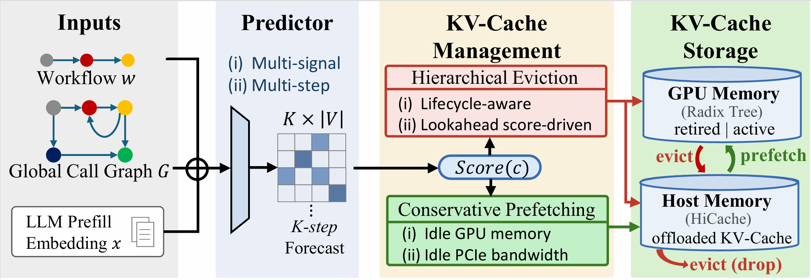
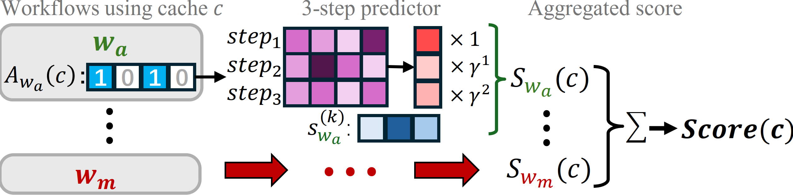

# PBKV: Prediction-Based KV Cache Management for Dynamic Agent Workflows

> **Accepted at NeurIPS 2026.**
>
> **Paper**: [*Efficient Serving for Dynamic Agent Workflows with Prediction-based KV-Cache Management*](https://arxiv.org/abs/2605.06472)

## Overview

**PBKV** is a KV-cache management system built on top of [SGLang](https://github.com/sgl-project/sglang) for LLM-based **multi-agent workflows**. It predicts future agent invocations to guide cache eviction and prefetching, supporting shared-context reuse across workflows with dynamic invocation orders.

PBKV's benefits become apparent as higher concurrency increases GPU memory pressure and triggers KV-cache eviction. With **Qwen3-32B** served on **2 × NVIDIA A6000 GPUs (48 GB each, TP=2)**, PBKV raises the GPU KV-cache hit rate from **27.09% to 69.10%** and achieves **1.85× end-to-end workflow speedup** over SGLang + HiCache with LRU on **HoVer + LangChain** at concurrency 72.

## System Overview



For each active workflow, a lightweight predictor produces a K-step forecast over upcoming agent invocations. The forecast drives a shared scoring function that feeds:

1. **Hierarchical Eviction** — first reclaims "retired" KV-cache from terminated workflows (chain-exclusive eviction), then applies score-driven eviction on active cache.
2. **Conservative Prefetching** — proactively loads likely-to-be-reused cache into GPU, but only into free or retired space, never displacing active cache.

## Cross-Workflow Reuse Score



`Score(c)` aggregates K-step predicted access probabilities across all active workflows, weighted by a survival probability and confidence decay factor γ, capturing the cross-workflow reuse value of each cache node.

## Quick Start

Install the SGLang runtime dependencies required by this repository in your serving environment.
Run the following from the repository root:

```bash
# Assign GPUs in this logical order: two for the LLM, then one for the predictor.
export CUDA_VISIBLE_DEVICES=0,1,2
export MODEL_PATH=/path/to/llm
export PREDICTOR_DIR=/path/to/predictor_directory
bash scripts/pbkv/launch.sh
```

The script runs full PBKV with prediction-based eviction and conservative prefetching.
Defaults are TP=2, predictor device `cuda:2`, a HiCache host-to-GPU cache capacity ratio of 1, page size 16, prediction horizon K=3, and decay factor γ=0.7.
Additional server arguments can be appended, for example `--port 30001 --max-total-tokens 16384`.
Use the `PYTHON_BIN` environment variable to select the Python interpreter for serving.

## Workflow Requests

Every PBKV request must explicitly provide all four fields below.
Pass them through the OpenAI client's `extra_body`, or include them in the request body when using the native `/generate` endpoint.
Missing or null fields return HTTP 400 before generation begins:

```python
extra_body = {
    "my_chain_id": "unique-workflow-id",
    "my_current_agent": "FactVerifier",
    "my_chain_history": ["Decomposer"],  # Prior agents only; excludes the current agent.
    "my_is_selector": False,
}
```

Agent names must match the vocabulary in the predictor checkpoint. Assign a unique ID to each workflow and reuse that ID for all requests within the workflow.
`my_chain_history` contains only previously invoked agents; pass `[]` for the first invocation.
Set `my_is_selector=False` for ordinary agent requests.
Selector requests must also provide all four fields: use the selector's name as `my_current_agent` and set `my_is_selector=True`. These requests do not update agent history or trigger predictions.
Once all requests in a workflow have finished, send a completion notification:

```bash
curl -X POST http://127.0.0.1:30000/my/chain_terminated \
  -H 'Content-Type: application/json' \
  -d '{"chain_id":"unique-workflow-id"}'
```

## Citation

If you use PBKV in your research, please cite:

```bibtex
@misc{zheng2026efficientservingdynamicagent,
  title={Efficient Serving for Dynamic Agent Workflows with Prediction-based KV-Cache Management},
  author={Haoyu Zheng and Fangcheng Fu and Jia Wu and Binhang Yuan and Yongqiang Zhang and Hao Wang and Yuanyuan Zhu and Xiao Yan and Jiawei Jiang},
  year={2026},
  eprint={2605.06472},
  archivePrefix={arXiv},
  primaryClass={cs.LG},
  url={https://arxiv.org/abs/2605.06472},
}
```
